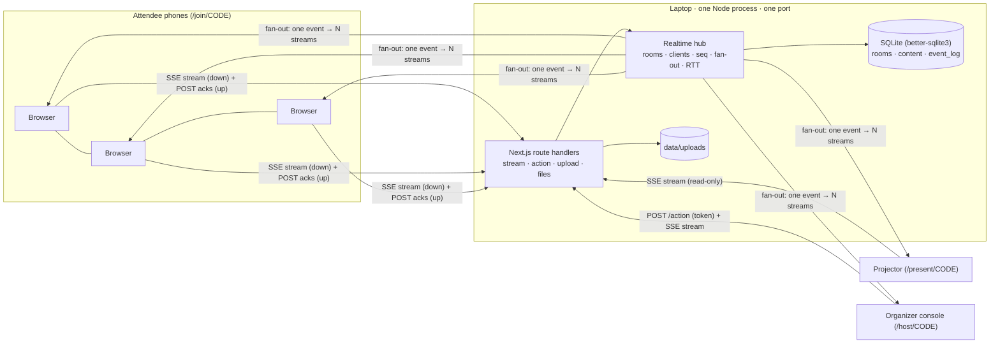

# CrowdCast

**Local-network event broadcasting.** An organizer creates a room on a laptop; the server shows a QR code and a LAN join URL. Attendees scan it on their phones (no app, no account) and instantly receive announcements, images, PDFs and **live presentation slides**, while the organizer watches connected devices, latency and delivery acks in real time. Everything runs on one laptop, on one port, with no internet and no external services (fonts, PDF worker and QR rendering are all bundled locally).

> **Screenshots** (captured from the running app; headless capture has no emoji font, so emoji show as boxes there)
> | Organizer console | Attendee (phone, following live slides) | Projector view | Network inspector |
> |---|---|---|---|
> |  |  |  |  |
>
> More: `docs/host-presentation.png`, `docs/host-devices.png`, `docs/host-settings.png`, `docs/landing-light.png`.

---

## ⚠️ How this build maps to the requested stack

This project was built inside a fixed runtime: **Next.js 16 (App Router) + SQLite via better-sqlite3 and Drizzle**, started with `next start` on **one port**. A Next.js route handler cannot upgrade a connection to a WebSocket, so a few pieces differ from the original brief. Every *feature* is implemented; the *plumbing* underneath is different:

| Requested | What is implemented | Why / effect |
|---|---|---|
| React + Vite + React Router | Next.js App Router (React 19), routes `/`, `/create`, `/host/:code`, `/join/:code`, `/present/:code`, `/ended/:code`, 404 | Same URLs, server-side streaming support. |
| Express + Socket.IO | Next route handlers + an in-process **realtime hub** (`src/server/services/hub.ts`). **Down-link = Server-Sent Events** (a persistent HTTP stream), **up-link = acknowledged HTTP POSTs** (`/api/rooms/:code/action`) | Still persistent, push-based, fan-out, with acks, RTT pings, backoff reconnect and a `lastSeq` sync handshake. It is *not* a WebSocket (it is half-duplex streaming + POST); the Network inspector labels the transport honestly as `sse`. |
| better-sqlite3 | **better-sqlite3 + Drizzle** with the five tables (`rooms`, `content_items`, `presentation_state`, `event_log`, `organizer_sessions`) auto-created on start | Exactly matches spec. Zero setup, 100% offline, persistent on disk (`./data/crowdcast.db`). |
| helmet / express-rate-limit / pino | `next.config.ts` security headers + CSP, a fixed-window limiter (`core.ts`), a JSON-lines logger with pino-compatible fields | Same protections, no Express. |
| npm-workspaces monorepo | Single package with `src/shared` (zod schemas + types shared by browser and server), `src/server`, `src/components`… | Shared schemas and types across client and server. |
| shadcn/ui | Small Radix-based primitives in `src/components/ui` (Dialog = `@radix-ui/react-dialog`) using the same token-driven approach | Fewer moving parts, same look. |
| `npm run seed/test/loadtest` | `npm test`, `npx tsx scripts/seed.ts`, `npx tsx scripts/loadtest.ts` | Fully supported. |

Uploaded files are stored under `data/uploads/<roomId>/` (the stable room *id*, not the code, so URLs survive "regenerate room code").

---

## Quick start

Requirements: **Node 20+** (22 tested). Zero external services required.

```bash
npm install
npm run build && npm start      # everything on ONE port (3000), database auto-initializes
```

On start the terminal prints the **LAN URL and a QR code** for the organizer console:

```
  CrowdCast is running
  Organizer console : http://192.168.1.20:3000/create
  Attendees join at : http://192.168.1.20:3000/join/<ROOM CODE>
```

1. Open the organizer URL on the laptop → **Create event room**.
2. Show the QR (Share dialog, or **Projector view** on the big screen).
3. Phones on the same Wi-Fi scan it → they're in. Send an announcement, image or PDF from the **Broadcast** tab.

**Dev mode** (hot reload): `npm run dev` → <http://localhost:3000>.

**Demo data:** `npx tsx scripts/seed.ts [--present]` creates a sample room (announcements incl. an urgent one, two images, a 6-slide PDF) and prints the links. The organizer PIN is `1234`: open `/host/<CODE>` and sign in with it.

**Docker:** `PUBLIC_BASE_URL=http://<laptop-lan-ip>:3000 docker compose up --build` (single container, SQLite on mounted volume). A container can't see the host's Wi-Fi address, so set `PUBLIC_BASE_URL` for a correct QR code.

### Tests, lint, type-check, load test

```bash
npx tsc --noEmit && npx eslint .          # zero errors
npx vitest run tests/unit                 # unit tests (room codes, LAN detection, zod schemas, seq/resync, UA/names)
CROWDCAST_URL=http://localhost:3000 npx vitest run   # + integration tests against a running server
CROWDCAST_URL=http://localhost:3000 npx tsx scripts/loadtest.ts 300 5   # 300 fake phones, 5 broadcasts
```

Integration tests cover: room creation, **20 clients receive a broadcast exactly once**, ack aggregation, **reconnect + resync by `lastSeq` without duplicates**, late-joiner snapshot, organizer-only events rejected for attendees, unknown events rejected, **fake PDF/image rejected by magic bytes**, real image/PDF upload, Range requests, path-traversal rejection, lock / max attendees / kick / PIN login, ending a room.

Reference result (laptop-class sandbox): 300 clients connected in ~4.5 s; **p50 103 ms, p95 137 ms, max 167 ms** per delivery, 100 % delivered.

---

## Architecture



**Request flow for “Send to all”:** organizer `POST /action {content_send}` → zod validation → organizer token check → DB insert → `broadcastSeq()` allocates `seq`, appends to `event_log`, encodes the frame **once** and writes it to every open stream → HTTP response is the **ack** (`delivered: N`) → clients POST `ack {seqs}` → the event log shows `ack 20/20`.

**Sync handshake:** every stream connects with `?lastSeq=N`. The server answers with `snapshot` (first join / too far behind / server lost state), `replay` (only events in `(N, current]` from `event_log`), or nothing. Clients drop duplicates (`seq <= last`) and force a resync on gaps (`src/shared/seq.ts`). Events produced while the snapshot is being built are buffered per client so nothing is lost or reordered.

### Data model (SQLite / Drizzle, `src/db/schema.ts`)

`rooms(id, code, name, description, organizer_token_hash, pin_hash, status, settings_json, created_at, ended_at)` · `content_items(id, room_id, seq, type, title, body, priority, pinned, expires_at, file_path, thumb_path, mime, size_bytes, page_count, delivered_to, created_at, updated_at, deleted_at)` · `presentation_state(room_id, active, content_id, current_slide, blank, updated_at)` · `event_log(room_id, seq, event, payload_json, created_at)` · `organizer_sessions(token_hash, room_id)` for PIN logins. Only **hashes** of the organizer token (SHA-256) and PIN (scrypt + salt) are stored.

### Realtime protocol

Client → server (`POST /api/rooms/:code/action`, body validated by the zod discriminated union in `src/shared/schemas.ts`; unknown `type` → 400):

| Event | Who | Purpose |
|---|---|---|
| `ping_measure {id}` | any | reply to a server ping → server computes RTT (rolling avg of 10) |
| `ack {seqs[]}` | attendee | delivery acknowledgements |
| `view_state {inSync}` | attendee | following live vs browsing alone |
| `reaction_send {emoji}` | attendee | capped 5 / 2 s per device |
| `sync_request {lastSeq}` | any | pull missed events over HTTP |
| `content_send / content_edit / content_delete / content_pin / content_resend` | **organizer** | feed management |
| `presentation_start / presentation_stop / slide_change / blank_toggle` | **organizer** | live presentation |
| `pointer_move {x,y,visible}` | **organizer** | laser pointer (≈20/s client throttle, 40 ms server floor) |
| `device_kick / device_mute` | **organizer** | moderation |
| `room_settings_update / room_end / room_regenerate` | **organizer** | room control (lock, name prompt, reactions, max attendees, PIN) |

Server → clients (`GET /api/rooms/:code/stream`, SSE; typed in `src/shared/events.ts`):

| Event | Audience | Seq'd | Purpose |
|---|---|---|---|
| `hello`, `snapshot`, `ready` | the connecting client | – | identity, full state, handshake result |
| `content_added / content_updated / content_removed` | room | ✅ | feed changes |
| `presentation_state / slide_changed` | room | ✅ | live slides |
| `room_state_changed` | room | ✅ | locked / ended / settings |
| `pointer_moved` | attendees + projector | – | laser dot (droppable under back-pressure) |
| `presence_update`, `device_list`, `stats_update`, `log_entry`, `organizer_state`, `reaction_batch` | organizer (+ projector for presence/reactions) | – | live console data |
| `kicked`, `error`, `ping` | per client | – | removal, errors, RTT probe every 5 s |

REST: `POST /api/rooms` · `GET /api/rooms/:code` · `POST /api/rooms/:code/organizer-login` · `POST /api/rooms/:code/upload` · `GET /api/files/:roomId/:name` · `GET /api/network-info` · `GET /healthz` (`/api/health`). Errors always look like `{ "ok": false, "error": { "code", "message" } }`.

---

## Finding your LAN IP

CrowdCast detects it automatically (private IPv4 on a non-virtual adapter, preferring `192.168.x.x`), prints it at startup, and lets you pick another candidate in the Share dialog. To check manually:

* **Windows:** `ipconfig` → *Wireless LAN adapter Wi-Fi → IPv4 Address*
* **macOS:** `ipconfig getifaddr en0` (Wi-Fi is usually `en0`)
* **Linux:** `hostname -I` or `ip -4 addr show scope global`

## Firewall

Allow inbound TCP on the server port (default **3000**) for the *private* network profile only.

* **Windows (admin PowerShell):** `New-NetFirewallRule -DisplayName "CrowdCast" -Direction Inbound -Protocol TCP -LocalPort 3000 -Action Allow -Profile Private`
  (Also make sure the Wi-Fi network is set to **Private**, not Public.)
* **macOS:** System Settings → Network → Firewall → Options → allow incoming connections for **node** (or turn the firewall off for the event).
* **Linux (ufw):** `sudo ufw allow from 192.168.0.0/16 to any port 3000 proto tcp` · **firewalld:** `sudo firewall-cmd --add-port=3000/tcp` (add `--permanent` to keep it)

## Hotspot tip (AP isolation)

Many campus / guest Wi-Fi networks enable **AP / client isolation**, which blocks phone-to-laptop traffic even though both are "on the same Wi-Fi". Symptoms: the page loads on the laptop but never on phones. Fix: turn on your **phone's hotspot**, join the laptop to it, restart CrowdCast (so it detects the new IP) and have attendees join the same hotspot. A small travel router also works.

## Troubleshooting

| Problem | Fix |
|---|---|
| Phones can't open the URL | Same network? Firewall rule? AP isolation (use a hotspot)? Is the QR using the right IP (Share dialog → *Network address in the QR*)? |
| QR shows `localhost` or a wrong IP | It never should. Pick the right adapter in the Share dialog, or set `PUBLIC_BASE_URL`. Docker needs `PUBLIC_BASE_URL`. |
| "Reconnecting…" forever | Laptop slept or changed network (the IP changed → rescan). Streams reconnect with back-off and resync by `lastSeq`. |
| Copy link does nothing on http:// | Handled with a fallback; if blocked, select the URL text manually. |
| Database corruption or reset | Delete `./data/crowdcast.db`; the server will recreate a fresh database automatically on start. |
| Uploads rejected with 422 | The file isn't what its extension claims (magic-byte check). Re-export the PDF/image. |
| Slides don't render on very old phones | pdf.js 5+ needs a modern browser (Safari 17.4+/Chrome 119+); use the *Download* button as fallback. |
| Port in use | `PORT=3100 npm start` |

## Networking concepts explained (and where they live)

| Concept | Where to look | How it is demonstrated |
|---|---|---|
| **Broadcasting / fan-out** | `hub.ts` → `fanout()`, `broadcastSeq()`; UI: Network → *Broadcast fan-out* + *Event log* | One send is serialised once and written to every stream; the log shows bytes, recipients and ack counts; the SVG pulses on each send. |
| **Persistent connections (the "socket")** | `api/rooms/[code]/stream/route.ts`, `hub.ts` → `openStream()`, client `lib/socket.ts` | A long-lived HTTP response (`text/event-stream`) carries server push; POSTs are the up-link. Heartbeat `ping` every 5 s; stale-link watchdog on the client. |
| **Local network communication** | `utils/lan.ts`, `api/network-info`, `startup.ts` (terminal QR), `SharePanel.tsx` | Detects private IPv4s (skips docker/VPN adapters), binds `0.0.0.0`, QR always encodes the LAN URL. |
| **Client-server architecture** | `src/app/api/**`, `services/actions.ts`, `src/shared/schemas.ts` | Thin clients render server-owned state; every mutation is a validated request; organizer actions are authorised server-side with a hashed token. |
| **Latency (RTT)** | `hub.ts` → `tickRoom()` (ping), `handlePong()`; UI: status pill, Devices tab, Network → RTT chart | Timestamped ping → client POST → server computes RTT; rolling average of 10 samples → quality badge (excellent / good / weak / poor). |
| **Reconnection & state recovery** | `lib/socket.ts` (backoff + jitter), `shared/seq.ts`, `hub.ts` → `bootstrap()`, `event_log` table | Per-room monotonically increasing `seq`, persisted log, `lastSeq` handshake: replay or snapshot; duplicates dropped; gaps force resync; survives a server restart. |
| **Flow control / flood protection** | `hub.ts` → `write()` (`desiredSize`), `sendPointer()`, `addReaction()`, `core.ts` → `rateLimit()` | Slow clients drop pointer frames instead of queueing; reactions and pointer events are capped. |

## Security notes

* Organizer token = 256-bit random, stored as SHA-256; PIN = scrypt + salt; PIN login is rate-limited (6/min) and issues a *separate* session token.
* Organizer-only actions are enforced in `performAction()`, never trusted from the client; unknown events fail zod validation.
* Uploads: magic-byte validation (`file-type`), EXIF stripped and re-encoded with `sharp`, 480 px WebP thumbnails, PDF page count via `pdf-lib`, random server-generated filenames, strict filename whitelist on read (no traversal), size limits (10 MB images / 30 MB PDFs), `Range` support, immutable caching, `nosniff` + sandbox CSP on files.
* Text is plain: rendered as React text nodes; only absolute `http(s)` URLs are auto-linked (`rel="noopener noreferrer nofollow ugc"`).
* CSP (production) is same-origin only, which is also what makes the app work offline; same-origin check on all mutating routes; rate limits on room creation, uploads, joins and PIN attempts.
* SIGTERM closes all realtime streams cleanly; clients reconnect and resync once the server is back. Ended rooms are read-only for 24 h, then deleted with their files by a cleanup job.

## Project layout

```
src/
  app/            routes (pages + /api route handlers), globals.css (design tokens)
  components/     ui/ (primitives, dialog, illustrations), host/ (console tabs), attendee/, present/, pdf/
  stores/         zustand: connection, feed, presentation, devices, ui
  hooks/          useRealtime, useRoom / useShareTargets
  lib/            socket.ts (single realtime service), api.ts, pdf.ts, linkify.tsx, session.ts, utils.ts
  server/         core.ts, services/{hub,actions,content,rooms,uploads,access}.ts, utils/{lan,room-code,ua,names}.ts, startup.ts
  shared/         types.ts, schemas.ts (zod), events.ts, seq.ts: used by browser and server
  db/             Drizzle schema + client
scripts/          seed.ts · loadtest.ts · make-icons.ts
tests/            unit/ · integration/ · helpers/
```

## Accessibility & design

Dark by default with a light toggle (respects `prefers-color-scheme`, persisted), all colours as CSS variables (`globals.css`), glass cards on an 8 px grid, spring-in feed items, animated counters, pulsing LIVE dot, skeletons, inline-SVG empty states, `sonner` toasts, `prefers-reduced-motion` honoured (`MotionConfig` + CSS), visible focus rings, `aria-live` announcements for new content on the attendee view, semantic tables/dialogs/switches, safe-area insets, installable PWA manifest + icons.

## License

MIT
